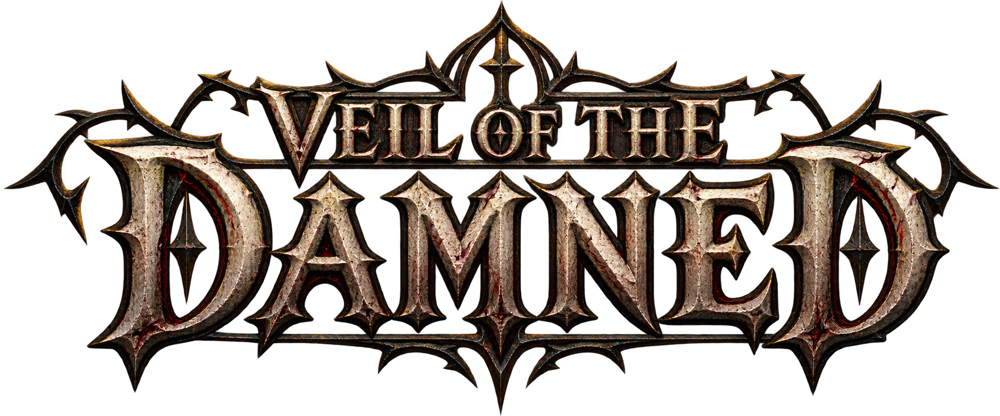

<p align="center">
  
</p>

<h3 align="center">RPG de ação roguelike gótico para Nintendo 64</h3>

<p align="center">
  Feito do zero para o hardware original do N64 · roda no console de verdade e em emuladores (ares, EverDrive, SummerCart64)
</p>

---

## Sobre o jogo

**Veil of the Damned** é um RPG de ação no estilo dos clássicos do fim dos anos 90: câmera isométrica, hordas de monstros, baús, cartas mágicas e chefes enormes. O universo, os personagens e o código são 100% originais. O jogo foi feito para um cartucho de **Nintendo 64**.

É um **roguelike**:
- os mapas são montados de forma procedural a cada partida;
- cada baú oferece uma carta que muda as habilidades do herói;
- morrer custa caro.

## Heróis

Próximas classes e mudanças de visual estão registradas em [TAREFAS.md](TAREFAS.md).

| Herói | Estilo | Habilidades |
|---|---|---|
| **Bárbaro** | Tanque de combate corpo a corpo, movido a **Fúria** | Combo de Machado, Salto Esmagador, Grito de Guerra, Redemoinho, Berserker e um salto de esquiva longo |
| **Caçadora** | Ágil, à distância, alto crítico | Tiro de Arco carregado, Rajada, Armadilha de Raízes, Gavião, Foco do Caçador, Camuflagem |
| **Druida** | Conjurador da natureza | Raio Espiritual, Erupção de Espinhos, Lobos Espectrais e Forma de Fera (lobisomem) |
| **Mago** | Conjurador de capuz e cajado | Kit provisório compartilhado com o Druida; novas magias serão definidas depois |
| **Ladino** | Classe em preparação | Bloqueado até receber seus sprites próprios |

Cada classe tem vida, dano, armadura, crítico e energia próprios, que crescem de forma diferente a cada nível.

O Bárbaro e o Mago começam liberados. O Ladino aguarda suas artes; os demais heróis são **segredos**: descobrir como libertá-los faz parte do jogo.

## Campanhas

Três campanhas, cada uma com três fases e um chefe próprio, e três dificuldades: **Normal**, **Pesadelo** e **Inferno**.

1. **O Norte Esquecido**: Passo Congelado (gelo escorregadio e nevasca), Cavernas de Gelo e o Trono do Jarl.
2. **Floresta Morta**: floresta sombria, pântano venenoso e o Coração Seco.
3. **Caminho dos Condenados**: cemitério em névoa, cripta e o Altar Negro.

Vencer uma campanha abre a próxima, e vencer uma dificuldade abre a seguinte.

## Recursos

- **Mapas procedurais:** blocos montados a cada partida, testados em milhares de sementes.
- **Cartas:** 72 cartas, 24 por herói, entre comuns, raras, lendárias e amaldiçoadas.
- **Baús selados:** cada um guarda um evento (emboscada, guardião ou vigília). Há também baús menores espalhados pelo mapa.
- **Mascate demoníaco:** troca essência demoníaca por poções, cartas e vidas extras.
- **Chefes:** combates difíceis, com fases e ataques que precisam ser lidos.
- **Animação:** sprites pré-renderizados no estilo dos ARPGs clássicos, com 12 quadros por animação nos heróis.
- **Idiomas:** inglês, português (BR) e espanhol.
- **Save:** salva na EEPROM do cartucho.
- **Expansion Pak:** opcional. Quando presente, aumenta o cache de sprites e melhora o desempenho.

## Controles

| Botão | Ação |
|---|---|
| Analógico | Mover |
| A | Ataque básico |
| B | Habilidade principal |
| C-esquerda / C-cima / C-direita | Habilidades |
| R | Esquiva (rolamento ou salto) |
| Z | Poção |
| D-pad esquerda | Minimapa |
| START | Pausa, status, habilidades e cartas |

## Como compilar

### Dependências externas

- **libdragon:** toolchain MIPS e SDK para N64 (padrão em `/opt/libdragon`, configurável via `$N64_INST`).
- **Python 3:** para o script de empacotamento do DragonFS (`tools/stage_rom_assets.py`).
- **Tiny3D:** biblioteca 3D, baixada e compilada em `deps/tiny3d` pelo script `./setup_deps.sh`.

### Passo a passo

1. Baixe e compile o Tiny3D:
```bash
./setup_deps.sh
```

2. Compile a ROM:
```bash
./build.sh
```

> **Dica:** o script `./build.sh` lida automaticamente com diretórios cujo caminho contenha espaços (criando um link temporário para o Make) e chama `make`. Caso prefira rodar `make` diretamente de um caminho sem espaços:
> ```bash
> export N64_INST=/opt/libdragon
> export T3D_INST=$PWD/deps/tiny3d
> make -j4
> ```

A compilação gera a ROM `veil_of_the_damned.z64` a partir dos ativos prontos para console em `assets/`. A arte bruta de alta resolução do PC não é necessária para compilar.

### Formatos dos recursos

- Personagens, monstros, chefes e cenários: CI8 (paleta de até 256 cores), com compressão sem perdas nível 2 do libdragon, incluindo o chão ilustrado.
- Músicas e efeitos: WAV64 mono, 12.000 Hz, com compressão VADPCM.
- Os nomes antigos `.rgba16` e `.rgba32` são mantidos para compatibilidade com as referências do jogo; o conteúdo dos sprites dessas pastas é CI8, definido explicitamente na compilação. Os PNGs de origem são preservados.
- A compressão do sprite é sem perdas sobre o CI8; a redução para 256 cores ocorre antes dela. A paleta CI8 usa alfa de 1 bit, inclusive nos recursos que antes tinham transparência gradual em RGBA32.

O carregamento de texturas 3D envia também as paletas, e a análise da base dos objetos lê a transparência na paleta CI8.

## Estrutura

| Pasta / Arquivo | Conteúdo |
|---|---|
| `src/`, `include/` | Código do jogo em C (libdragon + Tiny3D) |
| `assets/` | Sprites, cenário, cartas, fontes e áudio já convertidos para o N64 |
| `tools/stage_rom_assets.py` | Script de organização do manifesto de assets para a ROM |
| `Makefile`, `build.sh` | Compilação da ROM |
| `setup_deps.sh` | Baixa e prepara as dependências locais (Tiny3D) |

## Tecnologia

[libdragon](https://github.com/DragonMinded/libdragon) · [Tiny3D](https://github.com/HailToDodongo/tiny3d) · C · Python

---

<p align="center"><i>Projeto independente de fã do Nintendo 64. Não é afiliado à Nintendo.</i></p>
